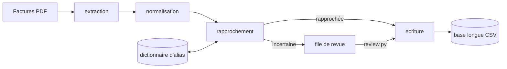

Deployed from https://github.com/GrIc/sdd-fabrik v3.3.0.

# Suivi des prix fournisseurs

Application locale pour le boulanger de LevainCoeur, seul utilisateur : elle lit ses factures fournisseurs, propose les
variations de prix, et ne les écrit dans son fichier de référence qu'une fois validées. Le pourquoi et les règles sont
dans [product.md](product.md), les choix dans [decisions.md](decisions.md). La façon de travailler est dans
[WORKFLOW.md](WORKFLOW.md), l'ordre du travail dans [roadmap.md](roadmap.md).

## Système

Le moteur existe en ligne de commande. L'interface et l'écriture dans le fichier `.xlsx` restent à bâtir : aujourd'hui
tout aboutit dans la base longue CSV.

Ce qui est difficile ici : les libellés fournisseurs ressemblent peu aux noms du fichier, les factures parlent en colis
quand le fichier parle en €/kg, et chaque PDF texte a sa mise en page. Une erreur ne se voit pas tout de suite : elle
fausse les marges plus tard. Le moteur tourne de bout en bout mais ses résultats ne sont pas encore fiables
([issue](issues/moteur-jamais-execute.md)), et la plupart des critères des contrats se vérifient à la main.

## Modules

| Module | Possède |
|---|---|
| [extraction](modules/extraction.md) | Lire un PDF fournisseur en lignes d'articles brutes |
| [normalisation](modules/normalisation.md) | Ramener un prix facturé à l'unité de comparaison |
| [rapprochement](modules/rapprochement.md) | Relier un libellé fournisseur à une matière, la cascade et ses alias |
| [ecriture](modules/ecriture.md) | Enchaîner le traitement d'un lot, la revue humaine, écrire les prix |
